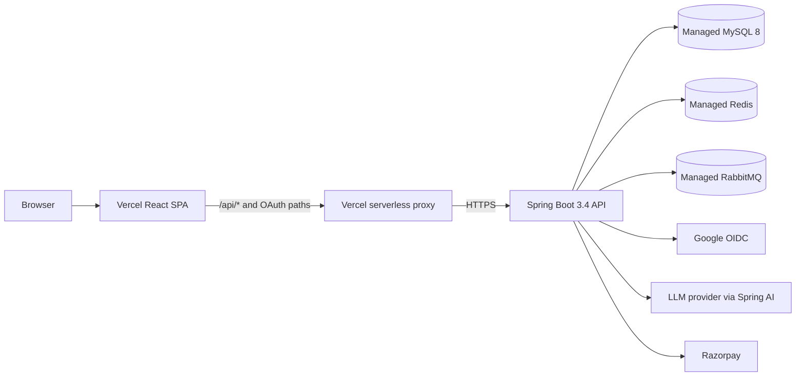

# Vercel frontend + hosted Spring Boot backend

## Architecture



Vercel hosts the React/Vite frontend and the included Node proxy functions. It does **not** host the ordinary Spring Boot process or persistent MySQL, Redis or RabbitMQ services. The Java backend must run on a Java/Docker-capable platform. MySQL, Redis and RabbitMQ should be managed services or private services available to that backend.

## 1. Deploy backend first

1. Create a managed MySQL 8 database and private/managed Redis and RabbitMQ instances if required by the selected profile.
2. Deploy `backend/` as a Docker web service using `backend/Dockerfile` (build context `backend`).
3. Supply all required backend environment values. At minimum, configure `DB_URL`, `DB_USERNAME`, `DB_PASSWORD`, `JWT_SECRET`, `SPRING_PROFILES_ACTIVE=prod`, `APP_SEED_ENABLED=false`, `FRONTEND_URL`, `APP_PUBLIC_URL`, `CORS_ALLOWED_ORIGINS`, cookie security variables and the private service URLs/credentials.
4. Set `SERVER_PORT` from the provider's assigned port if necessary. The Dockerfile exposes 8080; Spring Boot honours `SERVER_PORT`.
5. Confirm the service is healthy at `/actuator/health/readiness` from an allowed monitoring path. Do not expose actuator endpoints publicly.
6. Apply/verify Flyway migrations on a backup of any existing database before cutover.

Use the platform's secret manager. Do not commit `.env.production` or paste credentials into Vercel's `VITE_*` variables.

## 2. Deploy frontend on Vercel

1. Push the repository to GitHub.
2. In Vercel, import the repository.
3. Set **Root Directory** to `frontend`.
4. Framework preset: Vite. Install command: `npm install`. Build command: `npm run build`. Output directory: `dist`.
5. Add the Vercel environment variable `BACKEND_BASE_URL` for Production and Preview, set to the backend's HTTPS origin only, e.g. `https://cinebook-api.onrender.com` (no `/api`, no trailing path). This value is server-side for the proxy function and is not prefixed with `VITE_`.
6. Deploy. Deep links are handled by the SPA rewrite. API requests are routed to the function under `frontend/api/`; OAuth initiation/callback paths are proxied by dedicated functions so the browser stays on the Vercel hostname.

Do not set `VITE_API_BASE` to a backend host for the normal deployment; leave it as `/api`. This keeps refresh and OAuth cookies same-origin.

## 3. Google OAuth on Vercel

On the backend host, set:

```dotenv
FRONTEND_URL=https://your-app.vercel.app
APP_PUBLIC_URL=https://your-app.vercel.app
GOOGLE_CLIENT_ID=...
GOOGLE_CLIENT_SECRET=...
GOOGLE_REDIRECT_URI=https://your-app.vercel.app/login/oauth2/code/google
SESSION_COOKIE_SECURE=true
SESSION_COOKIE_SAME_SITE=lax
REFRESH_COOKIE_SECURE=true
REFRESH_COOKIE_SAME_SITE=Lax
CORS_ALLOWED_ORIGINS=https://your-app.vercel.app
```

Register the exact callback in Google Cloud Console. The OAuth initiation and callback are forwarded through Vercel's serverless proxy; `Cookie`, `Set-Cookie`, forwarded host and scheme headers must be preserved. The proxy code in this repository handles those headers, but the complete cross-provider browser round-trip still needs live validation with the actual domain and Google credentials.

For preview deployments, use a matching OAuth callback domain/client or disable Google sign-in in previews. Do not send a production Google client secret to preview frontend variables.

## 4. Database, Redis and RabbitMQ

Use connection endpoints reachable only by the backend (private networking where possible). Configure:

- `DB_URL`, `DB_USERNAME`, `DB_PASSWORD`
- `REDIS_HOST`, `REDIS_PORT`, `REDIS_PASSWORD`, `APP_REDIS_ENABLED=true`, `APP_CACHE_TYPE=redis`
- `RABBITMQ_HOST`, `RABBITMQ_PORT`, `RABBITMQ_USERNAME`, `RABBITMQ_PASSWORD`, `APP_MESSAGING_ENABLED=true`

Do not place database connection credentials in the Vercel project. Do not point a production app at ephemeral local container filesystems.

## 5. Other integrations

- SMTP: configure `MAIL_HOST`, `MAIL_PORT`, `MAIL_USERNAME`, `MAIL_PASSWORD`, `MAIL_FROM`; production signup requires verified email delivery.
- AI: configure `AI_API_KEY`, `AI_MODEL` and optional `AI_BASE_URL` on the backend only.
- Razorpay: configure test credentials and webhook secret first. Use the public backend webhook URL; the Vercel `/api` proxy forwards it. Do not enable live payments until you have verified signatures, duplicate webhook handling, refund behaviour and reconciliation.

## 6. Verification checklist

After deployment, check:

- `https://your-app.vercel.app/` loads and nested SPA paths return the React app.
- `GET /api/auth/google/status` returns a truthful enabled/disabled state.
- `GET /api/ai/status` reports AI configuration status.
- The backend health endpoint reports healthy from the host's monitoring interface.
- Browser network traces show API calls to the Vercel origin, not localhost.
- Login sets a Secure, HttpOnly `cinebook_refresh` cookie; JavaScript cannot read it; refresh rotates it; logout clears it.
- Google authorization returns to the registered callback and one-time code exchange sets the app session.
- Booking tests verify that two concurrent users cannot confirm the same seat.
- Razorpay test orders/webhooks behave as expected.

A successful Vercel static build is not proof that the backend, OAuth provider, mail relay, database or payments work. Record actual results separately.
